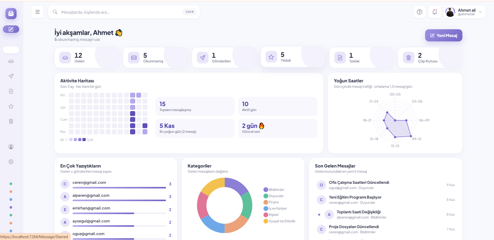
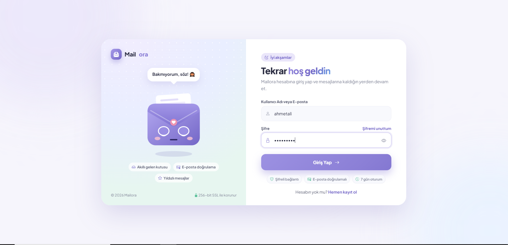
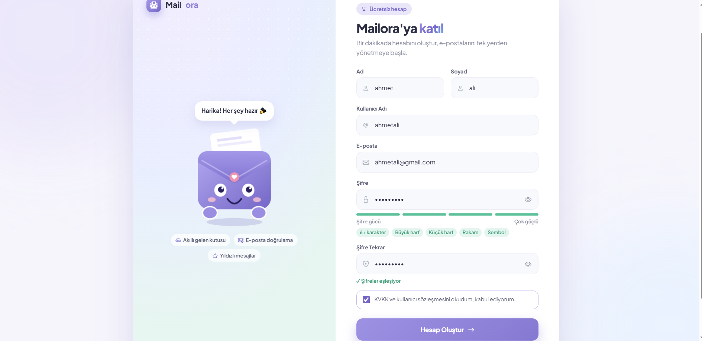
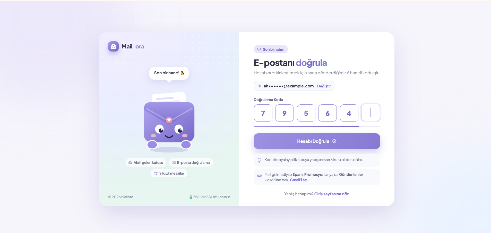
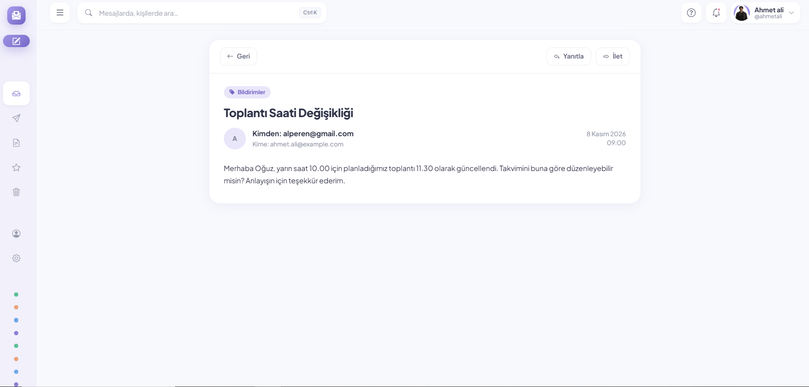
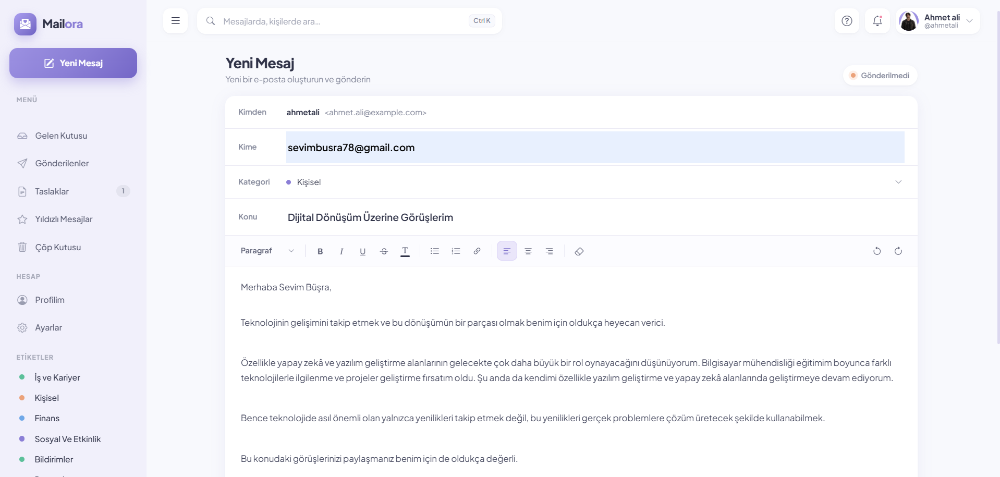
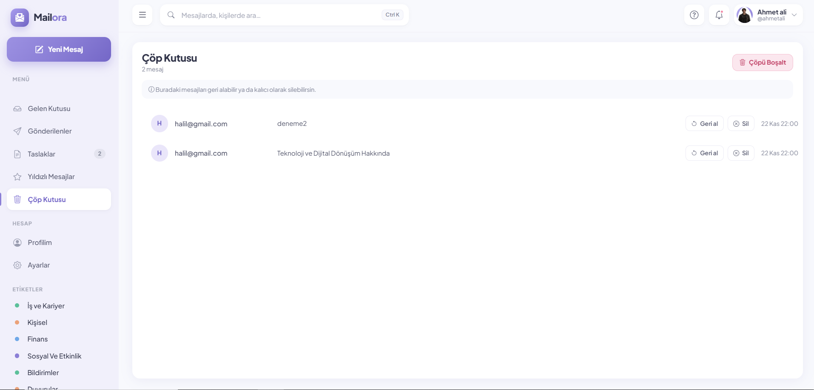

# 💌 Mailora

**ASP.NET Core Identity ile geliştirilmiş, modern arayüzlü bir uygulama içi e-posta / mesajlaşma platformu.**

Kullanıcılar kayıt olur, e-postalarına gelen 6 haneli kodla hesaplarını doğrular, birbirlerine kategorili mesajlar gönderir; gelen kutusu, taslaklar, yıldızlı mesajlar, çöp kutusu ve istatistik paneliyle mesajlarını tek yerden yönetir.

> M&Y Yazılım Eğitim Akademi — **Bootcamp 12. Dönem Identity Email Case** kapsamında, eğitmen **Murat Yücedağ** rehberliğinde geliştirilmiştir.



---

## 🛠️ Kullanılan Teknolojiler

| Alan | Teknoloji |
| --- | --- |
| Backend | .NET 9 · ASP.NET Core MVC |
| Kimlik doğrulama | ASP.NET Core Identity (UserManager, SignInManager, token sağlayıcıları) |
| Veritabanı | Entity Framework Core 9 · Code First · Microsoft SQL Server |
| E-posta | MailKit (SMTP · Gmail) |
| Güvenlik | HtmlSanitizer (XSS koruması) · AntiForgery · User Secrets |
| Arayüz | Razor Views · ViewComponents · Bootstrap 5 · Bootstrap Icons |
| Grafikler | Chart.js |

---

## ✨ Özellikler

### 🔐 Kimlik Doğrulama ve Hesap
- **Kayıt ol:** Ad, soyad, kullanıcı adı, e-posta ve canlı şifre gücü göstergesi. Aynı e-posta ile ikinci hesap açılamaz (`RequireUniqueEmail`).
- **E-posta doğrulama:** Kayıt sonrası e-postaya **6 haneli rastgele kod** gönderilir. Kod doğrulanmadan giriş yapılamaz.
- **Giriş:** Kullanıcı adı **veya** e-posta ile giriş, 7 gün oturum.
- **Şifremi unuttum:** Identity token'ı ile şifre sıfırlama bağlantısı. Bağlantı **1 saat** geçerlidir ve **tek kullanımlıktır**.
- **Şifre değiştirme:** Mevcut şifre doğrulanır, değişiklik sonrası kullanıcıya bilgilendirme e-postası gider.
- **Türkçe hata mesajları:** Identity'nin tüm hata mesajları özel bir `IdentityErrorDescriber` ile Türkçeleştirildi.

### 📬 Mesajlaşma
- **Gelen kutusu:** Arama, Tümü / Okunmamış / Okundu / Yıldızlı filtreleri, toplu seçim, okundu-okunmadı işaretleme.
- **Yeni mesaj:** Zengin metin editörü, kategori seçimi, **taslak olarak kaydetme**.
- **Yanıtla / İlet:** Orijinal mesaj alıntılanarak form otomatik doldurulur.
- **Gönderilenler, Taslaklar, Yıldızlı Mesajlar** sayfaları.
- **Çöp kutusu (soft delete):** Silinen mesaj önce çöpe gider, 5 saniyelik "Geri Al" imkânı vardır. Çöpten geri alma, kalıcı silme ve çöpü boşaltma desteklenir.
- **Kayıtlı olmayan alıcıya gerçek e-posta:** Alıcı Mailora'da kayıtlı değilse mesaj, MailKit ile gerçek e-posta adresine gönderilir.

### 📊 Dashboard
- Animasyonla sayan özet kartlar: gelen, okunmamış, gönderilen, yıldızlı, taslak, çöp.
- **Aktivite haritası:** GitHub tarzı, son 3 ayın her günü için mesaj yoğunluğu; toplam, aktif gün, en yoğun gün ve güncel seri istatistikleri.
- **Yoğun saatler** radar grafiği, **kategori dağılımı** halka grafiği.
- **En çok yazıştığın kişiler** sıralaması ve son gelen mesajlar.

### 👤 Profil
- Ad, soyad ve "Hakkımda" alanını düzenleme.
- Profil fotoğrafı yükleme / kaldırma.

### 🚧 Hata Sayfaları
- Özel tasarımlı **401**, **403** ve **404** sayfaları (`UseStatusCodePagesWithReExecute`).

---

## 🛡️ Güvenlik Önlemleri

- **XSS koruması:** Mesaj içerikleri kaydedilmeden önce `HtmlSanitizer` ile temizlenir.
- **IDOR koruması:** Kullanıcı yalnızca kendisine ait mesajları görebilir; başkasına ait bir mesajın adresi denendiğinde 404 döner.
- **CSRF koruması:** Tüm POST işlemlerinde AntiForgery token doğrulaması.
- **Gizli bilgiler kodda yok:** SMTP şifresi `appsettings.json` yerine **User Secrets** içinde tutulur.
- **Güvenli dosya yükleme:** Profil fotoğrafında boyut sınırı (2 MB), uzantı kontrolü, dosya imzası (magic bytes) kontrolü ve rastgele (GUID) dosya adı.
- **Kendine mesaj engeli** ve e-posta adresi biçim doğrulaması.

---

## 📸 Ekran Görüntüleri

| Giriş | Kayıt |
| :---: | :---: |
|  |  |

| E-posta Doğrulama | Dashboard |
| :---: | :---: |
|  |  |

| Gelen Kutusu | Mesaj Detayı |
| :---: | :---: |
|  |  |

| Yeni Mesaj | Çöp Kutusu |
| :---: | :---: |
|  |  |

| Profil | 404 Sayfası |
| :---: | :---: |
|  |  |

---

## 🚀 Kurulum

**Gereksinimler:** .NET 9 SDK, SQL Server (Express yeterli), Visual Studio 2022

1. **Projeyi klonla**
   ```bash
   git clone https://github.com/SevimBusraGul78/Mailora.git
   ```

2. **Bağlantı cümlesini düzenle**
   `Context/EmailContext.cs` içindeki `Server=...` kısmını kendi SQL Server adınla değiştir.

3. **Veritabanını oluştur**
   Package Manager Console'da:
   ```powershell
   Update-Database
   ```

4. **E-posta ayarlarını yap**
   `appsettings.json` içindeki `MailSettings` bölümünde `FromEmail` ve `UserName` alanlarına kendi Gmail adresini yaz. Şifreyi koda değil User Secrets'a ekle (Gmail **uygulama şifresi** gerekir):
   ```bash
   dotnet user-secrets set "MailSettings:Password" "uygulama-sifren"
   ```

5. **Çalıştır**
   Visual Studio'da **F5** ile başlat ve `https://localhost:7284` adresine git.

---

## 📁 Proje Yapısı

```
MYAcademy_IdentitiyEmailProject/
├── Context/          → EmailContext (IdentityDbContext)
├── Controllers/      → Register, ConfirmMail, Login, Password, Message, Dashboard, Profile, ErrorPages
├── Entities/         → AppUser, Message, Category
├── Migrations/       → EF Core migration'ları
├── Models/           → ViewModel'ler, TurkishIdentityErrorDescriber
├── Services/         → IMailService, MailService (MailKit), MailSettings
├── ViewComponents/   → Sidebar ve header bileşenleri
├── Views/            → Razor sayfaları
└── wwwroot/          → Statik dosyalar
```

---

## 👩‍💻 Geliştirici

**Sevim Büşra** — [GitHub](https://github.com/SevimBusraGul78)
