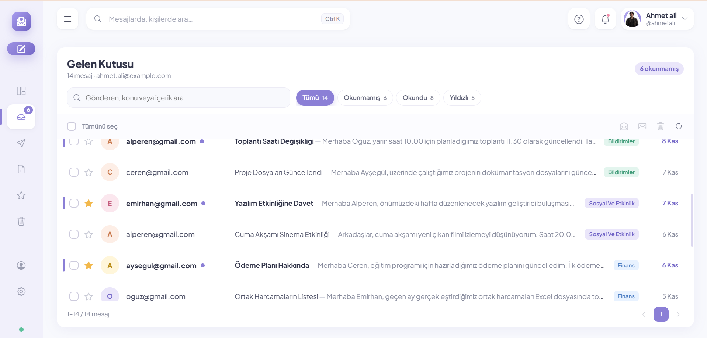
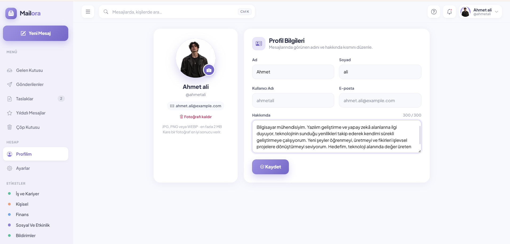
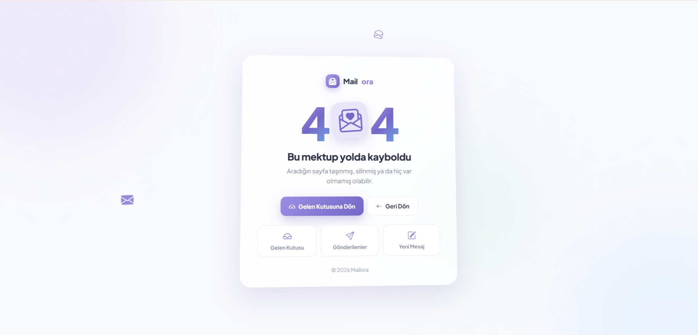

# 💌 Mailora

**Mailora**, ASP.NET Core Identity altyapısıyla geliştirilmiş, modern arayüzlü bir uygulama içi e-posta ve mesajlaşma platformudur.

Kullanıcılar kayıt olup e-postalarına gelen kodla hesaplarını doğrular, ardından birbirlerine kategorili mesajlar gönderip gelen kutusu, taslaklar, çöp kutusu ve istatistik paneliyle tüm yazışmalarını tek yerden yönetir.

> 🎓 Bu proje, **M&Y Yazılım Eğitim Akademi — Bootcamp 12. Dönem Identity Email Case** ödevi kapsamında, eğitmen **Murat Yücedağ** rehberliğinde geliştirilmiştir.


---

## 📑 İçindekiler

1. [Kullanılan Teknolojiler](#️-kullanılan-teknolojiler)
2. [Sayfalar ve Özellikler](#-sayfalar-ve-özellikler)
3. [Güvenlik Önlemleri](#️-güvenlik-önlemleri)
4. [Kurulum](#-kurulum)
5. [Proje Yapısı](#-proje-yapısı)

---

## 🛠️ Kullanılan Teknolojiler

| Teknoloji | Projede ne için kullanıldı? |
| --- | --- |
| **.NET 9 · ASP.NET Core MVC** | Uygulamanın temel iskeleti; sayfalar Controller → View yapısıyla oluşturuldu. |
| **ASP.NET Core Identity** | Kayıt, giriş, çıkış, şifre sıfırlama ve e-posta doğrulama gibi tüm kullanıcı işlemleri. |
| **Entity Framework Core 9 (Code First)** | Veritabanı tablolarının C# sınıflarından migration'larla oluşturulması ve sorgular. |
| **Microsoft SQL Server** | Kullanıcıların, mesajların ve kategorilerin saklandığı veritabanı. |
| **MailKit** | Doğrulama kodu, şifre sıfırlama bağlantısı ve bildirimlerin Gmail SMTP üzerinden gönderilmesi. |
| **HtmlSanitizer** | Mesaj içeriklerindeki zararlı HTML/JavaScript kodlarının temizlenmesi (XSS koruması). |
| **ViewComponents** | Sol menü ve üst bilgi çubuğu gibi her sayfada tekrar eden parçaların tek yerden yönetilmesi. |
| **Bootstrap 5 · Bootstrap Icons** | Duyarlı (responsive) sayfa düzeni ve arayüzdeki ikonlar. |
| **Chart.js** | Dashboard'daki radar ve halka grafikleri. |
| **User Secrets** | SMTP şifresi gibi gizli bilgilerin kod dışında, güvenli şekilde saklanması. |

---

## 📄 Sayfalar ve Özellikler

### 1. Giriş Sayfası
Kullanıcı, **kullanıcı adı veya e-posta adresiyle** giriş yapabilir; e-postasını doğrulamamış kullanıcılar sisteme alınmaz ve doğrulama sayfasına yönlendirilir.

- **Şifremi unuttum:** E-postaya 1 saat geçerli, tek kullanımlık bir şifre sıfırlama bağlantısı gönderilir.
- **7 gün oturum:** Giriş yapan kullanıcı 7 gün boyunca tekrar giriş yapmak zorunda kalmaz.
- **Maskot Mailo:** Şifre yazılırken gözlerini kapatan sevimli zarf maskotu, sayfaya canlılık katar.


### 2. Kayıt Sayfası
Yeni kullanıcı; ad, soyad, kullanıcı adı, e-posta ve şifre bilgileriyle hesap oluşturur.

- **Canlı şifre gücü göstergesi:** Şifre yazıldıkça büyük harf, küçük harf, rakam ve sembol kuralları anlık olarak kontrol edilir.
- **Benzersiz e-posta:** Aynı e-posta adresiyle ikinci bir hesap açılamaz.
- **Türkçe hata mesajları:** Identity'nin varsayılan İngilizce hata mesajları özel bir sınıfla Türkçeleştirildi.


### 3. E-posta Doğrulama
Kayıttan sonra kullanıcının e-postasına **6 haneli rastgele bir kod** gönderilir ve hesap ancak bu kod girildikten sonra aktif olur.

- **6 kutulu kod girişi:** Kod kopyalanıp ilk kutuya yapıştırıldığında 6 kutu birden otomatik dolar.
- **Maskelenmiş e-posta:** Gizlilik için e-posta adresi `ah•••••••@example.com` şeklinde gösterilir.


### 4. Dashboard
Kullanıcının mesaj trafiğini özetleyen, grafiklerle zenginleştirilmiş istatistik panelidir.

- **Özet kartlar:** Gelen, okunmamış, gönderilen, yıldızlı, taslak ve çöp kutusundaki mesaj sayıları animasyonla sayılarak gösterilir.
- **Aktivite haritası:** GitHub'daki katkı tablosuna benzer şekilde, son 3 ayın her günü mesaj yoğunluğuna göre renklendirilir.
- **Mini istatistikler:** Toplam mesajlaşma, aktif gün sayısı, en yoğun gün ve kaç gündür üst üste mesajlaşıldığı (seri) hesaplanır.
- **Yoğun saatler:** Radar grafiği, mesajların günün hangi saatlerinde yoğunlaştığını gösterir.
- **Kategoriler:** Halka grafiği, gelen mesajların kategorilere göre dağılımını gösterir.
- **En çok yazıştıkların:** Kullanıcının en çok mesajlaştığı 5 kişi, çubuk grafikle sıralanır.


### 5. Gelen Kutusu
Kullanıcıya gelen tüm mesajlar, okunmuş/okunmamış durumu ve kategori etiketiyle birlikte listelenir.

- **Filtreler:** Tümü, Okunmamış, Okundu ve Yıldızlı sekmeleriyle mesajlar tek tıkla filtrelenir.
- **Arama:** Gönderen, konu veya içerikte anlık arama yapılabilir.
- **Toplu işlemler:** Birden fazla mesaj seçilip okundu/okunmadı olarak işaretlenebilir ya da silinebilir.
- **Yıldızlama:** Önemli mesajlar yıldızlanarak "Yıldızlı Mesajlar" sayfasında toplanır.



### 6. Mesaj Detayı
Mesajın tamamı; gönderen, alıcı, tarih ve kategori bilgileriyle birlikte okunur.

- **Otomatik okundu:** Mesaj açıldığında otomatik olarak "okundu" durumuna geçer.
- **Yanıtla / İlet:** Orijinal mesaj alıntılanarak yeni mesaj formu otomatik doldurulur.


### 7. Yeni Mesaj
Zengin metin editörüyle (kalın, italik, liste, bağlantı vb.) biçimlendirilmiş mesajlar yazılıp kategori seçilerek gönderilir.

- **Taslak olarak kaydet:** Yarım kalan mesajlar "Taslaklar" sayfasına kaydedilip daha sonra düzenlenebilir.
- **Kayıtlı olmayan alıcı:** Alıcı Mailora'da kayıtlı değilse mesaj, MailKit ile gerçek e-posta adresine gönderilir.
- **Kendine mesaj engeli:** Kullanıcı kendi adresine mesaj gönderemez.


### 8. Çöp Kutusu
Silinen mesajlar veritabanından hemen silinmez, önce çöp kutusuna taşınır (soft delete).

- **Geri Al:** Silme işleminden sonraki 5 saniye içinde "Geri Al" butonuyla işlem iptal edilebilir.
- **Geri yükle / Kalıcı sil:** Çöpteki mesaj gelen kutusuna geri alınabilir veya kalıcı olarak silinebilir.
- **Çöpü boşalt:** Çöp kutusundaki tüm mesajlar tek tıkla temizlenir.


### 9. Profil
Kullanıcı ad, soyad ve "Hakkımda" bilgilerini düzenleyip profil fotoğrafı yükleyebilir.

- **Güvenli fotoğraf yükleme:** Dosyanın boyutu, uzantısı ve gerçekten bir resim olup olmadığı kontrol edilir.
- **Şifre değiştirme:** "Ayarlar" sayfasından mevcut şifre doğrulanarak yeni şifre belirlenir ve kullanıcıya bilgilendirme e-postası gönderilir.



### 10. Hata Sayfaları
Uygulamanın tasarımıyla uyumlu, özel **401**, **403** ve **404** hata sayfaları hazırlandı.

- **Yönlendirme kısayolları:** Kullanıcı tek tıkla gelen kutusuna, gönderilenlere veya yeni mesaj sayfasına dönebilir.



---

## 🛡️ Güvenlik Önlemleri

| Önlem | Açıklama |
| --- | --- |
| **XSS koruması** | Mesaj içerikleri kaydedilmeden önce HtmlSanitizer ile temizlenir, böylece zararlı kod çalıştırılamaz. |
| **IDOR koruması** | Kullanıcı yalnızca kendisine ait mesajları görebilir; başkasının mesaj adresi denenirse 404 döner. |
| **CSRF koruması** | Tüm form ve POST işlemlerinde AntiForgery token doğrulaması yapılır. |
| **Gizli bilgilerin korunması** | SMTP şifresi `appsettings.json` içinde değil, User Secrets'ta tutulur ve GitHub'a yüklenmez. |
| **Güvenli dosya yükleme** | Profil fotoğrafında 2 MB sınırı, uzantı ve dosya imzası kontrolü yapılır; dosya rastgele bir adla kaydedilir. |
| **Tek kullanımlık token** | Şifre sıfırlama bağlantısı 1 saat geçerlidir ve şifre değiştikten sonra tekrar kullanılamaz. |
| **E-posta doğrulama zorunluluğu** | Doğrulama kodu girilmeden hiçbir hesap sisteme giriş yapamaz. |

---

## 🚀 Kurulum

**Gereksinimler:** .NET 9 SDK, SQL Server (Express yeterli), Visual Studio 2022

1. **Projeyi bilgisayarına indir.**
   ```bash
   git clone https://github.com/SevimBusraGul78/Mailora.git
   ```

2. **Veritabanı bağlantısını ayarla.**
   `Context/EmailContext.cs` dosyasındaki `Server=...` kısmına kendi SQL Server adını yaz.

3. **Veritabanını oluştur.**
   Visual Studio'da *Package Manager Console*'u açıp aşağıdaki komutu çalıştır; tüm tablolar migration'lardan otomatik oluşturulur.
   ```powershell
   Update-Database
   ```

4. **E-posta gönderimini ayarla.**
   `appsettings.json` içindeki `MailSettings` bölümüne kendi Gmail adresini yaz, şifreyi ise güvenlik için User Secrets'a ekle (Gmail'den alınmış bir **uygulama şifresi** gerekir).
   ```bash
   dotnet user-secrets set "MailSettings:Password" "uygulama-sifren"
   ```

5. **Uygulamayı çalıştır.**
   Visual Studio'da **F5** tuşuna bas ve tarayıcıda `https://localhost:7284` adresine git.

---

## 📁 Proje Yapısı

| Klasör | İçerik |
| --- | --- |
| `Context/` | Identity tablolarını da içeren veritabanı bağlantı sınıfı (`EmailContext`). |
| `Controllers/` | Kayıt, doğrulama, giriş, şifre, mesaj, dashboard, profil ve hata sayfalarının controller'ları. |
| `Entities/` | Veritabanı tablolarına karşılık gelen sınıflar: `AppUser`, `Message`, `Category`. |
| `Migrations/` | EF Core'un veritabanı şemasını oluşturan migration dosyaları. |
| `Models/` | Sayfalara veri taşıyan ViewModel'ler ve Türkçe Identity hata mesajları. |
| `Services/` | MailKit ile e-posta gönderen servis (`IMailService`, `MailService`). |
| `ViewComponents/` | Sol menü ve üst bilgi çubuğu bileşenleri. |
| `Views/` | Tüm Razor sayfaları. |
| `wwwroot/` | CSS, JavaScript ve kütüphane dosyaları. |

---

## 👩‍💻 Geliştirici

**Sevim Büşra** · [GitHub](https://github.com/SevimBusraGul78)
